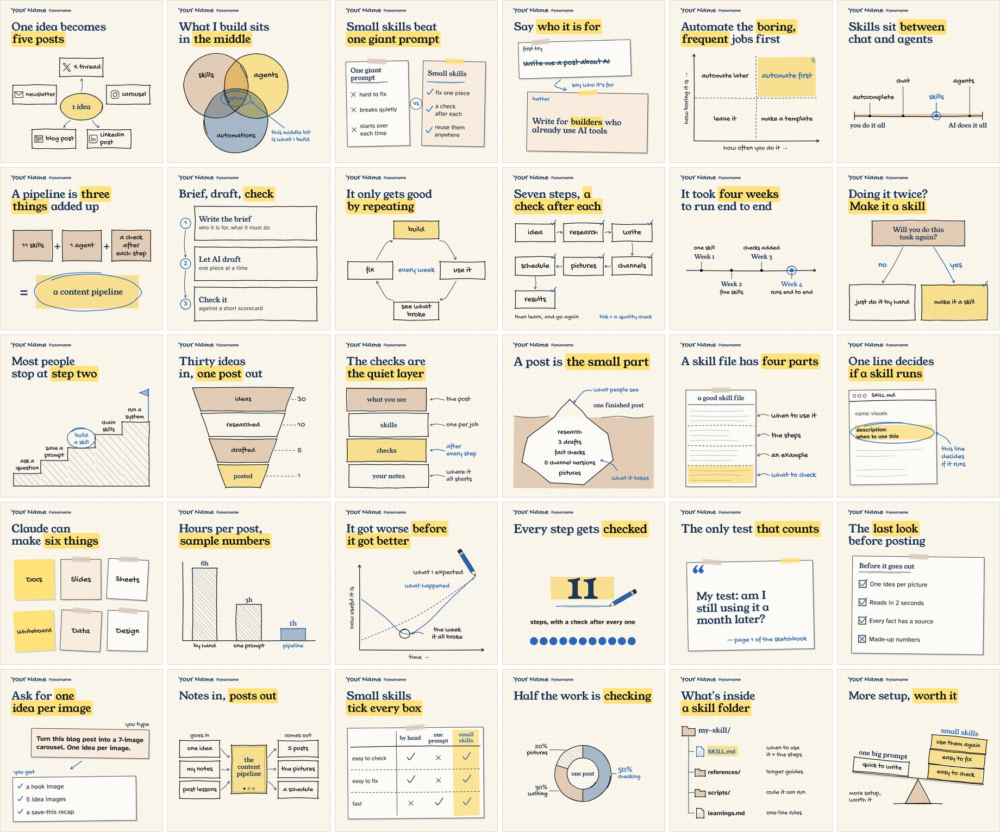

# Illustration

Give it an idea. It draws a finished hand-drawn picture: grid paper, black pen, a pencil, soft marker washes, taped-in paper and hand lettering. Every picture looks like it came from the same notebook, in the right size for each app.



**Works with any AI agent** that can read a skill folder and run Python. Version 1.0.0, MIT license.

## Setup

1. Put this folder where your agent reads skills. For Claude Code that is `.claude/skills/` in a project, or `~/.claude/skills/` for every project. Other agents: point them at this folder and its `SKILL.md`.
2. Have Python 3 and Chrome (or Chromium) on the computer. Nothing else to install: the fonts come with it, and it needs no internet.
3. Ask for your first picture. The skill first asks you 3 quick questions (what goes in the corner, which colors, which paper), each with 3 answers or your own, and saves them in `brand.json`.

## Example

Ask your agent: *"Make an Instagram carousel: 4 ways to write a better prompt."* It picks the right picture for each idea, writes one small post file, checks it, draws every image and looks at each one before giving them to you. `examples/carousel.json` is that post file, finished.

| Asked for | You get |
|---|---|
| An Instagram carousel or Story | 1080 x 1350 images with a cover, page numbers and a "next" hint, or 1080 x 1920 |
| An X image or article cover | 1600 x 900 or 2000 x 800 |
| A LinkedIn document | pages joined into one PDF |
| Blog pictures | wide for laptops, square for phones, day and night, plus a 1200 x 630 cover |
| A newsletter picture | 1200 x 1200 on soft paper |

## Make it your own

Answer the 3 setup questions, or edit `brand.json` any time:

| Choice | Options |
|---|---|
| Corner | your name and handle, your logo image, or nothing |
| Colors | `notebook` (cream, navy, blue pen, peach), `sea` (teal, coral), `ink` (grey, red), or your own colors |
| Paper | `grid`, `dots` or `plain`, in any color |
| Handles | one for every app, or a different one per app |

30 kinds of picture, each for one kind of idea (a loop, a comparison, steps, a funnel, a trade-off and more), plus hand-drawn app logos and small icons. You can add your own: see `references/pictures.md`.

## Known limits

- Pictures are PNG files (and PDF for LinkedIn). No animation.
- Needs Chrome or Chromium on the computer to draw.

## Folder map

```
SKILL.md                  what the agent reads (setup questions, steps, rules)
brand.json                your corner, colors and paper: the one file to change
references/pictures.md    the post file, the 30 pictures, sizes, icons
references/all-30.jpg     all 30 pictures on one sheet
examples/                 finished post files (carousel, blog, icons)
scripts/                  the engine (sketch.py is the command)
CHANGELOG.md              what changed in each version
LICENSE                   MIT (the fonts keep their own OFL licenses in scripts/fonts/)
```
