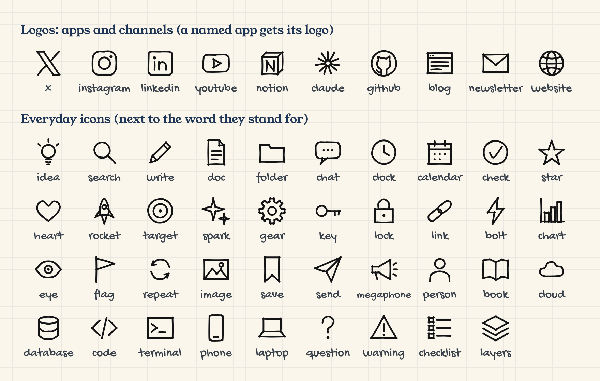

# Pictures: the post file, the 30 pictures, sizes, icons

Read this once before your first picture. Everything here is how to **draw**. Which picture fits an idea is in `SKILL.md` ("Pick the picture"), with the quick pick at the end of this file.

## Commands

Run them from the skill folder.

```bash
python3 scripts/sketch.py POST.json --check                                   # rule warnings in plain words, draws nothing
python3 scripts/sketch.py POST.json --out OUT --format ig-portrait            # Instagram carousel 1080x1350
python3 scripts/sketch.py POST.json --out OUT --format li-portrait            # LinkedIn document pages
python3 scripts/pdf.py OUT/li-portrait --out carousel.pdf                     #   ...joined into one PDF for LinkedIn
python3 scripts/sketch.py POST.json --out OUT --format inline                 # X images 1600x900 + OUT/x-cover.png from image 1
python3 scripts/sketch.py POST.json --out OUT --format blog-inline,blog-square --theme both   # blog: wide + phone square, day + night, + OUT/blog-cover.png
python3 scripts/sketch.py POST.json --out OUT --format nl-inline              # newsletter 1200x1200
python3 scripts/sketch.py POST.json --out OUT --format ig-story --only 1,5    # only some images
python3 scripts/sketch.py --list                                              # the 30 and the idea each one fits
python3 scripts/sketch.py --sampler OUT --format ig-square                    # one sample of each of the 30
python3 scripts/sketch.py --icons sheet.png                                   # every small icon and logo on one sheet
python3 scripts/brand.py                                                      # what brand.json says, and any problem in it
```

Files land in `OUT/<format>/NN-<type>.png` (`-dark` for the night version).

## Sizes

| Format | Size | For |
|---|---|---|
| `ig-portrait` | 1080 x 1350 | Instagram carousel or single post (never mix sizes in one carousel) |
| `ig-tall` | 1080 x 1440 | Instagram, the newer taller post |
| `ig-square` | 1080 x 1080 | Instagram square |
| `ig-story` | 1080 x 1920 | Instagram Story (top 270 px and bottom 380 px kept clear) |
| `li-portrait`, `li-square` | 1080 x 1350, 1080 x 1080 | LinkedIn document pages |
| `li-cover` | 1920 x 1080 | LinkedIn article cover |
| `inline` | 1600 x 900 | X image (also makes `x-cover.png` from image 1) |
| `x-cover` | 2000 x 800 | X article cover |
| `x-portrait` | 1080 x 1350 | X tall image |
| `blog-inline` | 1600 x 900 | blog picture for laptops (also makes `blog-cover.png` from image 1) |
| `blog-square` | 1080 x 1080 | the same blog picture for phones, where wide words get too small |
| `blog-cover` | 1200 x 630 | blog cover and link preview |
| `nl-inline` | 1200 x 1200 | newsletter (soft paper, never pure white, lettering 48 px or more) |

Several at once: `--format ig-portrait,ig-square`. Night version: `--theme dark`, or `both` for day and night.

## The post file

```json
{"job": "save",
 "slides": [
  {"hero": {"type": "fix", "before": "Write a post about sleep", "after": "Write for ==new parents== who sleep 5 hours"},
   "kicker": "Fix 1",
   "title": "Say ==who it's for==",
   "sub": "The reader changes every word.",
   "note": "",
   "next": "give it one job",
   "alt": "A crossed-out prompt, and under it the better one: write for new parents who sleep 5 hours."}
 ]}
```

| Field | What it is |
|---|---|
| `hero` | the picture: `type` (1 of the 30) plus its data, see the tables below |
| `title` | the headline. It states the point. `==words==` = highlighter (once per image), `**words**` = colored pen, `~~words~~` = crossed out |
| `kicker` | small handwritten line above the headline ("Step 2") |
| `sub` | one plain sentence under the headline |
| `note` | handwritten note in the pen color, with an arrow down to the picture |
| `facts` | up to 2 small cards under the picture: `[{"label": "…", "text": "…", "hl": true}]` (tall formats) |
| `next` | carousel only: the "next: …" hint at the bottom |
| `alt` | alt text, written for a person: the point, not the look |
| `job` | on the post (or image 1): `save`, `send` or `repost` |
| `pick` | inside `hero`: which item gets the ONE colored pen mark (count from 0) |
| `handles` | on the post, optional: a different handle for this post only, e.g. `{"x": "@other"}` |
| `more`, `more_label` | on the post, optional: the last carousel image says "more at yoursite.com"; change the words here |
| `paper` | on the post, optional: `"soft"` puts this post on paper in your soft wash color |

## What the engine adds by itself

- **Your corner** (from `brand.json`): top left with the app's handle on Instagram, X and LinkedIn; bottom right with your site on blog pictures.
- **Carousels** (Instagram, LinkedIn): image 1 gets the big cover headline and the pencil rule, every image gets "next: …" and its page number, the last image gets "more at" and your site.
- **Covers:** X and blog formats also make the cover (`x-cover.png`, `blog-cover.png`) from image 1.
- Words shrink to fit their space (down to a floor), and the drawing is centered in the room it has.
- **Night version** (`--theme dark` or `both`): the same drawing on dark paper, for blogs with a dark mode.

## The 30 pictures

All of them on one sheet: `references/all-30.jpg` (sample words). Redraw it any time with `--sampler`.

**How things connect**

| # | `type` | Use it when the idea is… | Data (copy and change) |
|---|---|---|---|
| 1 | `hub` | 1 thing becomes many, or many feed 1 | `{"center": "1 idea", "items": ["X thread", "carousel", "LinkedIn post", "blog post", "newsletter"], "dir": "out"}` |
| 2 | `venn` | things that overlap; the middle is the point | `{"sets": ["skills", "agents", "automations"], "middle": "systems", "note": "this middle bit is what I build"}` |
| 3 | `compare` | A vs B, wrong way vs right way, myth vs fact | `{"left": {"title": "One giant prompt", "points": ["hard to fix", "breaks quietly"], "good": false}, "right": {"title": "Small skills", "points": ["fix one piece", "a check after each"], "good": true}}` |
| 4 | `fix` | first try crossed out, then the better version | `{"before": "Write me a post about AI", "after": "Write for ==builders== who already use AI tools", "note": "say who it's for"}` |
| 5 | `matrix` | 2 questions at once (a 2 by 2) | `{"x": "how often you do it →", "y": "how boring it is →", "cells": ["automate later", "automate first", "leave it", "make a template"], "pick": 1}` |
| 6 | `spectrum` | a scale between two ends, and where things sit | `{"left": "you do it all", "right": "AI does it all", "marks": [{"label": "chat", "at": 0.38}, {"label": "skills", "at": 0.64}, {"label": "agents", "at": 0.9}], "pick": 1}` |
| 7 | `equation` | parts that add up to a result | `{"parts": ["11 skills", "1 agent", "a check after each step"], "result": "a content pipeline"}` |
| 27 | `table` | a few options checked against the same questions | `{"cols": ["by hand", "one prompt", "small skills"], "rows": [{"label": "easy to check", "cells": [true, false, true]}, {"label": "fast", "cells": [false, true, true]}], "pick": 2}` (a cell is `true`, `false` or a short word; up to 4 columns, 6 rows) |
| 30 | `balance` | a trade-off: two sides weighed, one wins | `{"left": {"title": "one big prompt", "points": ["quick to write"]}, "right": {"title": "small skills", "points": ["easy to check", "easy to fix"]}, "note": "more setup, worth it"}` (the side with more points tips down, or set `"heavier": "left"`; up to 3 points a side) |

**How it happens**

| # | `type` | Use it when the idea is… | Data (copy and change) |
|---|---|---|---|
| 8 | `steps` | a how-to in order (2 to 5 steps) | `{"steps": [{"title": "Write the brief", "text": "who it is for"}, {"title": "Let AI draft", "text": "one piece at a time"}, {"title": "Check it"}]}` |
| 9 | `loop` | something that repeats or feeds itself | `{"nodes": ["build", "use it", "see what broke", "fix"], "center": "every week"}` |
| 10 | `pipeline` | a long process with a check after each step | `{"steps": ["idea", "research", "write", "pictures", "schedule", "results"]}` (exactly 4 steps draw as a big 2 by 2 unless the space is very wide) |
| 11 | `timeline` | what happened when | `{"events": [{"when": "Week 1", "what": "one skill"}, {"when": "Week 2", "what": "five skills"}, {"when": "Week 4", "what": "runs end to end"}], "pick": 2}` |
| 12 | `tree` | a choice: if this, go that way | `{"question": "Will you do this task again?", "branches": [{"when": "no", "then": "just do it by hand"}, {"when": "yes", "then": "make it a skill", "good": true}]}` |
| 13 | `ladder` | levels you climb, one after another | `{"levels": ["ask a question", "save a prompt", "build a skill", "chain skills", "run a system"], "pick": 2}` |
| 14 | `funnel` | many go in, few come out | `{"stages": [{"label": "ideas", "value": "30"}, {"label": "drafted", "value": "5"}, {"label": "posted", "value": "1"}]}` |
| 26 | `machine` | things go in, one system works on them, things come out | `{"in": ["one idea", "my notes"], "box": "the content pipeline", "out": ["5 posts", "the pictures"]}` (`pick` marks one thing that comes out; up to 4 in, 4 out) |

**What it is made of**

| # | `type` | Use it when the idea is… | Data (copy and change) |
|---|---|---|---|
| 15 | `layers` | what sits on top of what | `{"layers": [{"label": "what you see", "note": "the post"}, {"label": "skills", "note": "one per job"}, {"label": "your notes", "note": "where it all starts"}], "pick": 1}` |
| 16 | `iceberg` | the small part people see, the big part they don't | `{"above": ["one finished post"], "below": ["research", "3 drafts", "fact checks", "pictures"]}` |
| 17 | `anatomy` | one thing with its parts named | `{"thing": "a good skill file", "parts": ["when to use it", "the steps", "an example", "what to check"], "pick": 3}` |
| 18 | `screen` | a tool or page, with one part pointed out | `{"title": "SKILL.md", "lines": ["name: my-skill", "", ""], "at": 1, "highlight": "description: when to use this", "note": "this line decides if it runs"}` |
| 19 | `stickies` | a set of equal things, in no order | `{"items": ["Docs", "Slides", "Sheets", "Whiteboard", "Data", "Design"]}` |
| 29 | `folder` | what is inside a folder, a file or a kit | `{"root": "my-skill/", "items": [{"name": "SKILL.md", "note": "the steps"}, {"name": "scripts/", "note": "code it can run"}], "pick": 0}` (a name ending in `/` draws as a folder; `"depth": 2` tucks an item inside the one above; up to 7 items) |

**Numbers** (real numbers only: the drawing wobbles, the numbers never do)

| # | `type` | Use it when the idea is… | Data (copy and change) |
|---|---|---|---|
| 20 | `bars` | a few real numbers side by side | `{"bars": [{"label": "by hand", "value": 6}, {"label": "one prompt", "value": 3}, {"label": "pipeline", "value": 1}], "unit": "h", "pick": 2}` |
| 21 | `curve` | how something changes over time | `{"x": "time →", "y": "how useful it is", "lines": [{"label": "what I expected", "shape": "up", "main": false}, {"label": "what happened", "shape": "dip", "main": true}], "mark": {"at": [0.38, 0.18], "label": "the week it all broke"}}` |
| 22 | `bignumber` | one number worth remembering | `{"value": "11", "label": "steps, with a check after every one", "dots": [11, 11]}` |
| 28 | `donut` | shares of one whole (numbers that add up) | `{"parts": [{"label": "checking", "value": 50}, {"label": "writing", "value": 30}, {"label": "pictures", "value": 20}], "unit": "%", "center": "one post", "pick": 0}` (up to 5 parts) |

`curve` lines take a ready shape (`up`, `down`, `flat`, `hype`, `hockey`, `dip`, `s`, `plateau`) or your own `points` (pairs from 0 to 1); `label_at` moves a label.

**Words**

| # | `type` | Use it when the idea is… | Data (copy and change) |
|---|---|---|---|
| 23 | `quote` | a real, exact quote | `{"text": "My test: am I still using it a month later?", "by": "who said it"}` |
| 24 | `checklist` | rules, do's and don'ts, things to tick off | `{"title": "Before it goes out", "items": [{"text": "One idea per picture", "ok": true}, {"text": "Made-up numbers", "ok": false}]}` |
| 25 | `prompt` | what to type and what you get | `{"ask": "Turn this blog post into a 7-image carousel.", "answer": ["a hook image", "5 idea images", "a save-this recap"]}` |

Keep labels to 1 to 4 words.

## Shape quick pick

| The idea is… | Picture |
|---|---|
| 1 becomes many, many feed 1 | `hub` |
| things overlap, the middle matters | `venn` |
| A vs B, wrong vs right, myth vs fact | `compare` |
| a first try, then the better version | `fix` |
| a trade-off, two sides weighed and one wins | `balance` |
| a few options against the same questions | `table` |
| two questions at once | `matrix` |
| a scale between two ends | `spectrum` |
| parts that add up | `equation` |
| a how-to, 2 to 5 steps | `steps` |
| it repeats | `loop` |
| a long process with a check after each step | `pipeline` |
| things go in, one system works, things come out | `machine` |
| what happened when | `timeline` |
| if this, then that | `tree` |
| levels to climb | `ladder` |
| many in, few out | `funnel` |
| what sits on what | `layers` |
| small visible part, big hidden part | `iceberg` |
| one thing, its parts named | `anatomy` |
| a tool or file, one part pointed out | `screen` |
| what is inside a folder, a file or a kit | `folder` |
| a set of equal things | `stickies` |
| real numbers side by side / over time / one number / shares of a whole | `bars` / `curve` / `bignumber` / `donut` |
| an exact quote / rules to tick / what to type | `quote` / `checklist` / `prompt` |

## Per channel

| Channel | Format | Words per image | Shape of the set |
|---|---|---|---|
| Instagram carousel | `ig-portrait` | about 40 | 5 to 12 images, never 2 to 4. Cover = a statement of 6 to 10 words. A recap worth saving near the end. |
| Instagram single or Story | `ig-portrait` / `ig-story` | about 40 / fewer | one idea |
| X | `inline` (+ `x-cover`) | 25 to 40 | one image per explainer, readable without tapping |
| LinkedIn document | `li-portrait`, joined with `scripts/pdf.py` | 25 to 35 | 6 to 10 pages, page 1 works alone |
| LinkedIn article cover | `li-cover` | few | |
| Blog | `blog-inline,blog-square --theme both` (+ `blog-cover`) | about 40; cover 3 to 6 | a cover plus a picture right after each paragraph it explains |
| Newsletter | `nl-inline` | about 15 | one or a few pictures |

## Icons and logos



Small hand-drawn drawings that sit **next to a word** inside a picture. Same black pen as everything else: no icon font, no emoji, no brand colors. They live in `scripts/icons.py`.

| Kind | Which | When they appear |
|---|---|---|
| **App logos** (10) | `x`, `instagram`, `linkedin`, `youtube`, `notion`, `claude`, `github`, `blog`, `newsletter`, `website` | **By themselves**: when a label names the app ("X thread", "LinkedIn post", "blog post"), its logo is drawn beside the words. |
| **Everyday icons** (39) | `idea`, `search`, `write`, `doc`, `folder`, `chat`, `clock`, `calendar`, `check`, `star`, `heart`, `rocket`, `target`, `spark` (AI, agent), `gear` (skill, system), `key`, `lock`, `link`, `bolt`, `chart`, `eye`, `flag`, `repeat`, `image`, `save`, `send`, `megaphone`, `person`, `book`, `cloud`, `database`, `code`, `terminal`, `phone`, `laptop`, `question`, `warning`, `checklist`, `layers` | **Only when asked**: per item `{"label": "11 skills", "icon": "gear"}`, or `"icons": "auto"` on the picture, which guesses from the words and draws them only if **every** item finds one. |

- They work in 11 pictures: `hub`, `loop`, `pipeline`, `machine`, `equation`, `stickies`, `steps`, `table` (column heads), `layers`, `funnel`, `anatomy`. The others ignore icons.
- A label meant for an app but not naming it: `{"label": "carousel", "icon": "instagram"}`. Refuse one: `"icon": false`. None in a picture: `"icons": false`.
- **A sprinkle, not wallpaper.** App logos come free (they are names). Everyday icons go on about **1 image in 3** of a set; `--check` warns above that. An icon never replaces its word.
- App logos are hand-drawn to **name** the app, nothing more: black pen only, never in the app's colors, never placed to suggest a partnership.

### Adding a logo or icon
When a picture needs one that is missing, draw it and add it. Never use an emoji, an icon pack or a pasted logo file instead.
1. Write a small function in `scripts/icons.py` (it draws in a 1 by 1 box with the `G` helpers). A few strokes, readable at 40 px.
2. Add it to `LOGOS` or `ICONS`, and the words that find it to `LOGO_WORDS` or `ICON_WORDS` (other names for it go in `NAMES`).
3. Redraw the sheet and look at it, day and night: `python3 scripts/sketch.py --icons references/icons-and-logos.png --theme both`.

## Adding a picture
Only when no picture has the idea's shape. Write `def name(P, d)` in `scripts/pictures.py` (draw inside `P.w` x `P.h`, sizes in `P.u`, lettering never under `P.small`), add it to `PICTURES` with its group, shape and a sample, run `--sampler` and look at it in `ig-portrait`, `ig-square`, `inline` and `--theme dark`.

## Files
`scripts/sketch.py` page layout, checks, drawing · `scripts/brand.py` reads `brand.json` (your corner, colors, paper) · `scripts/pictures.py` the 30 pictures · `scripts/icons.py` the small icons and logos · `scripts/pen.py` the pens (wobbly lines, washes, paper, tape, pencil, lettering) · `scripts/rough.py` hand-drawn line maths · `scripts/sketch.css` the default colors and fonts, day and night · `scripts/pdf.py` joins pages into one PDF · `scripts/fonts/` the 3 fonts and their licenses.
